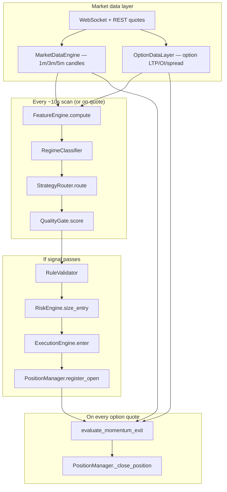

# Algo-Flat — End-to-End Trading Flow

This document describes how the **live trading engine** works today, traced from the actual code (`trading-engine/src/algoflat/`). It covers setup detection → entry → position management → exit.

**Entry point:** `main.py` → `TradingOrchestrator` (`trading/orchestrator.py`)

**Config roots:** `config/*.yaml` (loaded via `CONFIG_DIR`)

---

## 1. High-level picture



---

## 2. Engine startup (`main.py`)

On boot the engine:

1. **Connects to Flattrade** (session / auto-login if configured).
2. **Builds contract universe** — NIFTY weekly options, ATM strike, expiry series (`contract_selector/`).
3. **Starts background tasks:**
   - `orchestrator.run_periodic_scan()` — timer loop every `scan_interval_seconds` (default **10s**).
   - `_run_rest_poll_loop()` — REST backup for quotes when WS is thin.
   - `_run_market_feed_loop()` — WebSocket market feed.
   - Broker position reconcile + log maintenance.
4. **Loads prior-day levels** (PDH/PDL/close) for CPR/gap setups.
5. **Initializes risk state** in Postgres (`daily_risk_state`).

Universe **rolls on expiry** after 15:30 IST on expiry day (`main.py` → `_maybe_roll_universe`).

---

## 3. When does a “scan” run?

Two triggers feed the same `_scan_for_entry()` path (protected by `_scan_lock` to prevent double entries):

| Trigger | Source | Cadence |
|--------|--------|---------|
| **Periodic** | `run_periodic_scan()` | Every `scan_interval_seconds` (10s) while market open |
| **Quote-driven** | `on_quote()` after position updates | At most once per `scan_interval_seconds` |

**Open positions** are updated on **every** option quote via `positions.on_quote()` (exits), independent of the entry scan throttle.

Files: `orchestrator.py` — `run_periodic_scan`, `on_quote`, `_scan_for_entry_inner`

---

## 4. Market data & timeframes

### Candles (`MarketDataEngine`)

| Interval | Used for |
|----------|----------|
| **1m** | Session VWAP, 1m triggers, ATR for regime, opening range |
| **3m** | Setup detection (reclaim, pullback), bars-with-bias counts |
| **5m** | Structural bias (spot vs VWAP), 5m structure (HH/HL), level sweeps |
| **15m** | **Aggregated from 5m** (`aggregate_from_m5`) — counter-bias / peak reversal fade, MTF patterns |

**Regime classifier** uses **1m + 5m only** (not 3m/15m directly).  
**Feature engine** uses all four; 15m is derived, not a separate broker feed.

File: `features/engine.py`, `regime/classifier.py`

### Option chain context (each scan)

Before routing, orchestrator:

1. **Retargets ATM** from live spot.
2. Builds **ATM±2** option quote map (`_band_option_states`).
3. Builds **chain snapshot** (OI, PCR, max pain) → `features.set_chain_snapshot`.
4. Sets **option context** (LTP, spread, volume, OI, Greeks) → `features.set_option_context`.
5. **Recomputes features** with chain + Greeks.

File: `orchestrator.py` — `_refresh_chain_and_option_context`

---

## 5. Feature computation (`FeatureEngine.compute`)

Single snapshot per scan containing:

| Field | Meaning |
|-------|---------|
| `nifty_spot` | Live spot / futures LTP |
| `session_vwap` | VWAP from **1m** session candles |
| `bias_5m` | BULLISH / BEARISH / NEUTRAL — **5m close vs VWAP** (fallback 1m) |
| `setup_3m` / `trigger_1m` | VWAP reclaim paths |
| `extra.strategy_setups` | All detected setups (pullback, trend, ORB, gap, expiry scalping, etc.) |
| `extra.structure_5m` | `hhhl` / `lllh` / `mixed` |
| `extra.mtf_alignment` | Multi-timeframe pattern score |
| `extra.level_map` | PDH/PDL/CPR/OR levels for breakout/rejection |
| Counter-bias fields | `peak_reversal_fade` using **5m + 15m** |

Setups are detected in `features/setups.py` + `features/counter_bias.py` from config in `strategy_config.yaml`.

File: `features/engine.py`

---

## 6. Regime classification (`RegimeClassifier`)

**Purpose:** Decide if the **session environment** allows new trades (`regime.trade_allowed`).

**Inputs:** `FeatureSnapshot`, **1m** candles, **5m** candles, expiry-day flag.

**Logic (scores → primary regime):**

| Signal | Source |
|--------|--------|
| Trend up/down | `bias_5m` vs VWAP |
| Sideways | Mixed 5m structure, tight 5m range |
| High / low volatility | 1m ATR vs its average |
| Opening / late session | Clock since 09:30 IST |
| Breakout | Distance from VWAP |
| Expiry behaviour | Weekly expiry day |

**Blocks trading when:**

- `block_sideways` and primary = sideways (unless trend structure exception).
- `risk_score` > `max_risk_score_to_trade` (default 85).
- Missing spot or VWAP.

If `regime.trade_allowed == false`, router returns **NO_TRADE** immediately (no scanner entries).

Files: `regime/classifier.py`, `config/strategy_config.yaml` → `regime:`

---

## 6b. Gap up / gap down open (`gap_mode`)

**Measured at session open:** `gap_points = today_open − prior_close` (from prior-day load).

| `gap_class` | Condition |
|-------------|-----------|
| `gap_up` | gap ≥ `gap_mode.min_gap_points` (default 35) |
| `gap_down` | gap ≤ −min_gap_points |
| `flat` | otherwise |

**During opening phase** (`opening_range` regime, first ~45m after 09:30):

- Router applies **gap allowlist** — only gap/ORB setups run (not blind VWAP trend).
- `gap_up_allowed_strategies` / `gap_down_allowed_strategies` in `strategy_config.yaml`.

**Setups:**

| Setup | Gap up | Gap down |
|-------|--------|----------|
| `gap_and_go` | CE if price still rising vs open | PE if still falling |
| `gap_fade` | PE if rejection at OR high / VWAP | CE if rejection at OR low |
| `opening_range_breakout` | CE above OR high | PE below OR low |

**Entry timing:**

- Data from **09:15**; entries from **09:30** (`entry_start_time`).
- First **15 minutes** after 09:30: `gap_and_go` + ORB skip 2-scan confirm (fast open entries).
- Open phase TOD gate: confidence ≥ **82**, MTF ≥ 50.

**Traps (`validator_config.yaml` → `trap_avoidance.gap_open`):**

- On **gap down**: block trend **CE** (`vwap_trend`, `momentum`, etc.) while spot is still **above OR low** — avoid catching the knife.
- On **gap up**: block trend **PE** while spot is still **below OR high**.

Files: `features/setups.py`, `features/gap.py`, `validator/gap_open_traps.py`, `config/strategy_config.yaml` → `gap_mode:`

---

## 7. Strategy scanners (`scanner/library.py`)

Enabled list: `config/strategy_config.yaml` → `router.enabled_strategies`:

- `vwap_reclaim`, `vwap_pullback`, `vwap_rejection`, `vwap_trend`
- `opening_range_breakout`, `gap_and_go`, `gap_fade`, `pdh_pdl_break`
- `momentum_continuation`, `trend_day`, `expiry_scalping`
- `peak_reversal_fade`, `level_rejection`
- (others exist in code but are disabled unless listed)

Each scanner:

1. Reads `FeatureSnapshot` + `ContractUniverse`.
2. If its setup flag is true in features → emits `CandidateSignal` (side CE/PE, token, tsym).
3. Resolves strike via **`resolve_side_contract`** — ATM-first, then ATM±2 Greek picker (`contract_selector/strike_picker.py`).

If no scanner fires → `no_strategy_produced_signal`.

---

## 8. Strategy router (`StrategyRouter.route`)

For **each enabled scanner**:

1. Run `scanner.scan()` → signal or `None`.
2. If signal → **QualityGate.score()** → confidence 0–100.
3. Pick **highest confidence** signal.

**Minimum to proceed:** `confidence >= router.min_confidence` (default **76**).

If below min or no signal → `NO_TRADE` with reason logged.

File: `strategy/router.py`, `quality/gate.py`

---

## 9. Quality gate (`QualityGate`)

Weighted score (rulebook §9) from:

| Component | Max pts |
|-----------|---------|
| Spot vs VWAP alignment | 20 |
| Option VWAP | 15 |
| Market regime fit | 15 |
| Volume, OI, EMA, delta, gamma, theta, IV, spread | remainder |

Output: `(confidence: int, logs: list)` attached to signal.

`StrategyLearner` can nudge scores from historical setup performance (`reports/strategy_learner.json`).

File: `quality/gate.py`

---

## 10. Pre-entry validation (`RuleValidator`)

After router picks a signal, **before order**:

| Check | Config |
|-------|--------|
| Entry window | `validator_config.yaml` — 09:30–15:00 IST |
| Time-of-day phases | Stricter confidence/MTF at open & late session |
| Expiry-day cautious | Higher min confidence on expiry (82) |
| Trap avoidance | VWAP alignment, EMA structure, MTF score, level proximity, pullback trigger |
| Liquidity | spread, volume, OI (if broker sends them) |
| Duplicate token | Already open same instrument |
| Cooldown | Global + per-token after exit (`cooldown_after_exit_minutes`, default 2) |
| Kill switch | Risk engine block |

Failed validation → journal `validation_results` + `entry_skipped` event → **no order**.

Files: `validator/engine.py`, `validator/trap_avoidance.py`, `config/validator_config.yaml`

---

## 11. Risk & position sizing (`RiskEngine.size_entry`)

After validation passes:

1. **Snapshot** capital — pooled `daily_risk_state` (paper) or broker margin (live).
2. **Confidence → deploy %** — dynamic sizing (`confidence_lot_sizing` in `risk_config.yaml`).
3. **Greeks multiplier** — scales budget by delta/gamma/IV quality.
4. **Caps:**
   - `max_premium_pct_of_available` (90%)
   - `max_deployed_pct_of_equity` (90%)
   - Expiry day: `expiry_day_sizing.max_capital_pct` (90%)
   - Optional per-strategy lot caps
5. **`fit_lots_to_capital`** → integer lots × lot_size (65 for NIFTY).

Rejects if: insufficient capital, max concurrent (if set), max daily loss, max consecutive losses.

File: `risk/engine.py`, `config/risk_config.yaml`

---

## 12. Execution & position open (`ExecutionEngine.enter`)

1. **Reserve capital** in DB.
2. **Create order** journal row → `orders`.
3. **Place order** via broker (`MKT` MIS by default).
4. **Resolve fill price** from broker order fill (live **requires** fill; no LTP fallback).
5. **Open position** journal row → `positions` with **entry_price = fill price**.
6. **Register** in `PositionManager` (`register_open_from_order`).
7. Telegram alert on entry (if enabled).

Files: `execution/engine.py`, `position/manager.py`, `journal/writer.py`

---

## 13. Position monitoring & exits

### Quote path

Every **option LTP tick** → `PositionManager.on_quote()`:

1. **LTP sanity filter** — reject quotes jumping > `max_ltp_jump_pct_per_tick` (15%).
2. Update **MFE / MAE**.
3. Call **`evaluate_momentum_exit()`**.

### Exit priority (`position/exit_rules.py`)

| Priority | Reason | Notes |
|----------|--------|-------|
| 1 | `force_exit` | 15:10 IST (`risk_config.force_exit_time`) |
| 2 | `max_loss_inr` | If configured (0 = disabled) |
| 3 | `adverse_momentum` | Hard stop ~3–4% premium loss (confidence-scaled). **Bypasses min_hold** |
| 4 | `min_hold_seconds` | Soft exits blocked until 15s (60s for broker-adopted) |
| 5 | `time_stop` | Max hold 25 min if not in profit |
| 6 | `early_invalidation` | Never went +2% green → cut at ~5% loss |
| 7 | `momentum_trail` | Breakeven once green; above +4% MFE lock peak−2% |
| 8 | `trend_reversal` | Spot crosses VWAP against position (min 180s hold, underwater only) |

**Exit confirmation:** soft exits need `exit_confirm_ticks` (2) consecutive ticks before close.

**On close:**

- SELL order via broker.
- `closed_trades` row with P&L.
- Release capital, start **cooldown** (global 2 min).
- `StrategyLearner.record_trade()`.
- Optional **trend_reversal_flip** queue (disabled: `flip_on_trend_reversal: false`).

File: `config/position_exit_config.yaml`, `position/manager.py`

---

## 14. Broker sync (live only)

Periodically `reconcile_broker_holdings()`:

- Adopts broker positions **only if** today's algo BUY fill exists (no `netavgprc` fallback).
- Skips adopt during exit cooldown.
- External closes detected after 2 missed reconcile cycles.

This path created `broker_adopted` setup type in past sessions — now gated.

File: `position/manager.py` — `reconcile_broker_holdings`

---

## 15. What gets logged (audit trail)

| Stage | DB table / event |
|-------|------------------|
| Scan decision | `system_events` (`strategy_decision`) |
| Candidate signal | `candidate_signals` |
| Validation | `validation_results` |
| Order | `orders` |
| Open position | `positions` |
| Close | `closed_trades` |
| Skip reason | `system_events` (`entry_skipped`) |

UI: Decision Logs, Trade Blotter, Position Watch (SSE stream).

---

## 16. Honest backtest parity (`scripts/day_backtest.py`)

Replay uses the **same** router, validator, exit rules, and sizing — but:

- Data = saved **1m snaps** (not live ticks).
- Regime uses 1m + 5m on historical bars.
- No broker adopt / LTP spike guard / exit confirm ticks (partial live parity).

For live vs backtest comparison use `scripts/live_backtest_parity.py`.

---

## 17. Typical “NO_TRADE” reasons (why few entries)

From scan → trade funnel:

```
~2000+ scan ticks/day
  → regime_blocks_trade (sideways, late session, high risk)
  → no_strategy_produced_signal (no setup flag true)
  → best_confidence < 76
  → validator: MTF too low, trap, level proximity, expiry confidence
  → cooldown_active (2 min after each exit)
  → capital_or_deploy_cap
  → few entries filled
```

---

## 18. Key file map

| Area | Path |
|------|------|
| Main loop | `trading-engine/src/algoflat/main.py` |
| Orchestrator | `trading-engine/src/algoflat/trading/orchestrator.py` |
| Features | `trading-engine/src/algoflat/features/engine.py` |
| Regime | `trading-engine/src/algoflat/regime/classifier.py` |
| Scanners | `trading-engine/src/algoflat/scanner/library.py` |
| Router | `trading-engine/src/algoflat/strategy/router.py` |
| Quality | `trading-engine/src/algoflat/quality/gate.py` |
| Validator | `trading-engine/src/algoflat/validator/engine.py` |
| Risk | `trading-engine/src/algoflat/risk/engine.py` |
| Execution | `trading-engine/src/algoflat/execution/engine.py` |
| Exits | `trading-engine/src/algoflat/position/exit_rules.py` |
| Positions | `trading-engine/src/algoflat/position/manager.py` |
| Strategy config | `config/strategy_config.yaml` |
| Validator config | `config/validator_config.yaml` |
| Risk config | `config/risk_config.yaml` |
| Exit config | `config/position_exit_config.yaml` |
| Runtime cadence | `config/runtime_config.yaml` |

---

## 19. One-scan sequence (summary)

```
1. Refresh 1m/3m/5m candles (skip if stale)
2. FeatureEngine → bias, setups, levels, MTF, chain
3. RegimeClassifier → trade_allowed?
4. For each enabled strategy → CandidateSignal?
5. QualityGate → confidence
6. Router → best signal ≥ 76?
7. RuleValidator → pass?
8. RiskEngine → lots & capital OK?
9. ExecutionEngine → BUY fill
10. PositionManager → track MFE/MAE
11. On each quote → exit rules → SELL when triggered
```

---

_Last updated from codebase audit — Jul 2026. For architecture blueprint see [ARCHITECTURE.md](../ARCHITECTURE.md)._
